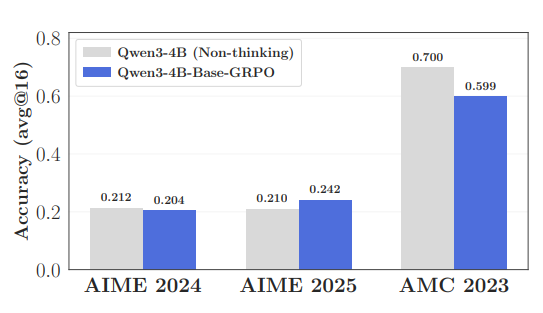
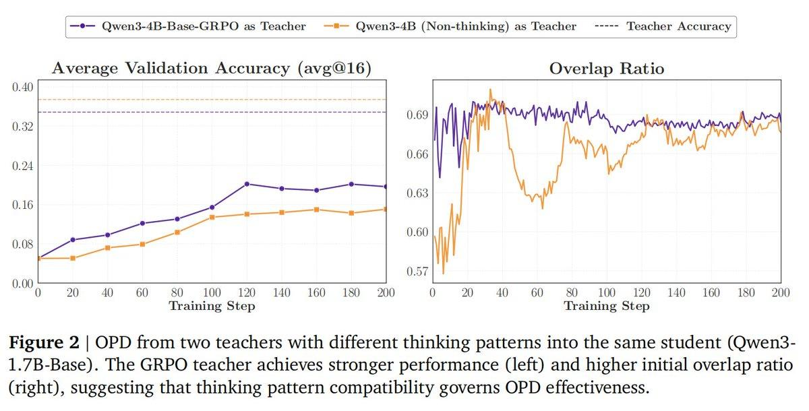

> **一句话结论：** OPD 是否有效，不由教师的参数量或 benchmark 分数单独决定，而取决于两件事：师生是否具有兼容的局部高概率分布，以及教师是否真的拥有学生尚未学到的能力。成功训练的直接机制，是在学生自己访问的状态上不断对齐师生共享的高概率 token。

这篇笔记只依据论文 v2 的[官方 PDF](https://arxiv.org/pdf/2604.13016)和[作者代码仓库](https://github.com/thunlp/OPD)整理。`[论文]` 表示作者报告的结论，`[分析]` 表示我基于论文证据做的归纳，`[假设]` 表示仍需实验验证的方向。这里的“thinking pattern”沿用论文术语，具体指师生在学生访问状态上的 top-$k$ token 分布兼容性，不把它扩大解释成完整的语义推理风格。

## 1. 现有方法及其缺陷：为什么还要重新研究 OPD？

### 从 off-policy 蒸馏到 on-policy 蒸馏

传统 off-policy Knowledge Distillation（KD）或 Supervised Fine-Tuning（SFT）让学生学习教师预先生成的固定序列。它的优点是简单稳定，但存在 **train–inference mismatch**：训练时学生沿着教师轨迹学习，推理时却必须沿自己的分布继续生成。一旦早期生成偏离教师轨迹，误差会在长序列中累积，这就是 exposure bias。[论文：PDF pp. 2, 18]

On-Policy Distillation（OPD）把监督位置换到了学生自己访问的状态：先由学生生成 rollout，再让教师对每个学生前缀给出逐 token 概率。这样既能缓解 exposure bias，又能获得比 outcome reward 更稠密的监督。

但更大或 benchmark 分数更高的教师，并不保证带来更好的蒸馏结果。论文因此把两个问题分开考察：教师是否具备学生未掌握的能力，以及学生当前的分布能否利用教师信号。[论文：PDF pp. 2, 5–8]

### 三种常见 OPD 实现也各有代价

| 方法 | 做法 | 优点 | 局限 |
|---|---|---|---|
| Sampled-Token OPD | 每个位置只使用学生实际采样的 token | 计算最轻；是 token-level reverse KL 的无偏单样本估计 | 单次监督不全面，低概率 token 的修正较慢；详见下方补充笔记 |
| Full-Vocabulary OPD | 每个位置计算全词表 KL | 监督最完整、梯度最密 | 内存开销为 $O(BTM)$，随 batch、长度和词表规模增长 |
| Top-$k$ OPD | 只在学生的 top-$k$ token 上计算重归一化 KL | 保留多 token 监督，同时降低教师查询成本 | 丢弃集合外概率质量，只是 full-vocabulary KL 的近似 |

**我的补充笔记：Sampled-Token OPD 的局限**

1. **监督信号不全面：** 单次采样只提供一个 Token 的误差信息，无法直接指导 Student 应该提高哪些 Token 的概率、降低哪些 Token 的概率，缺少完整的相对调整信息。
2. **低概率 Token 难以纠正：** 例如 Teacher 给“香蕉”35%，Student 仅给 5%，那么 Student 采到“香蕉”的概率很低，导致相关监督信号出现频率低、修正缓慢，需要更多采样才能充分学习。


所以，这篇论文真正追问的不是“OPD 能不能工作”，而是：

> **学生只会做自己熟悉的题。老师即使给出每个选项的完整评分，这些信息何时才能让学生进步？如果无效，问题出在教师能力、师生分布不兼容，还是训练方法没有利用好这些信息？**

## 2. 发现的问题：Teacher 自身表现为何无法决定 OPD 效果？

固定 Student（Qwen3-1.7B-Base）与训练数据（DAPO-Math-17K），分别使用 Qwen3-4B（Non-thinking）和 Qwen3-4B-Base-GRPO 进行 OPD。

### 2.1 反常现象：GRPO Teacher 自身并不更强，蒸馏出的 Student 反而更好



*Figure 3（论文第 6 页）：两位 Teacher 在 AIME 2024、AIME 2025 和 AMC 2023 上的原始准确率。*

GRPO Teacher 在 AIME 2024 和 AMC 2023 上低于 Non-thinking Teacher，只在 AIME 2025 上更高，三项平均也略低。论文因此将两位 Teacher 视为总体可比，但 GRPO Teacher 的自身表现并不更强。



*Figure 2（论文第 6 页）：左图比较同一 Student 分别向两位 Teacher 学习后的验证准确率，虚线表示 Teacher 自身准确率；右图比较师生 Overlap Ratio。紫线对应 GRPO Teacher，橙线对应 Non-thinking Teacher。*

Figure 2 左图却显示，使用 GRPO Teacher 蒸馏的 Student 在训练中持续优于使用 Non-thinking Teacher 的 Student。于是出现了一个反常结果：**在多数独立 benchmark 上表现更好的 Non-thinking Teacher，并没有训练出更好的 Student；反而是 GRPO Teacher 带来了更高的蒸馏准确率。**

Figure 2 右图进一步给出解释线索：GRPO Teacher 与 Student 的初始 Overlap Ratio 更高。Overlap Ratio 表示师生 top-$k$ 高概率 token 的重合比例，越高说明两者在 Student 当前状态上的局部预测分布越兼容。

虽然两组 overlap 在训练后期逐渐接近，但左图中的 Student 性能差距仍然存在。作者据此认为，训练早期的思考模式错配会损失蒸馏收益，而且这种损失后期难以追回。

> **第一个发现：** OPD Teacher 的选择不能只看 Teacher 自身准确率，还要看它与 Student 的初始 thinking-pattern compatibility。图 2–3 支持这一解释，但兼容性是否足以保证 OPD 成功，还需要下一组对照检验。[论文：PDF p. 6，Figs. 2–3]

### 2.2 仅有兼容性还不够：Teacher 还需要提供新的可迁移能力


*Figure 4（论文第 7 页）：左图为 DeepSeek 家族，右图为 Qwen 家族。紫线表示经过额外 RL 的 Teacher，橙线表示同训练流水线的 Teacher；曲线为 Student 的 avg@16，框内给出 Initial Overlap Ratio 与 Gap Recovery Rate。*

为区分“Teacher 自身表现更强”和“Teacher 的能力能否迁移给 Student”，论文在两个模型家族内固定 Student、OPD 数据和训练配置，只改变 Teacher：

- **DeepSeek 家族：** 对比 DeepSeek-R1-Distill-Qwen-7B 与在其基础上继续 RL 得到的 Skywork-OR1-Math-7B；
- **Qwen 家族：** 对比 Qwen3-4B（Non-thinking）与在其基础上继续数学 RL 得到的 Qwen3-4B-Non-Thinking-RL-Math。

图中需要区分三项指标：

1. **Accuracy（avg@16）——Student 最终学得怎么样。** 每道题采样 16 个回答，再计算平均正确率。曲线直接反映 Student 在 OPD 训练中的绝对性能变化。
2. **Gap Recovery Rate——Teacher 的能力实际传递了多少。** 它衡量 Student 通过 OPD 弥补了多少初始师生性能差距：

$$
\text{Gap Recovery Rate}
=\frac{\mathrm{Acc}_{\text{after OPD}}-\mathrm{Acc}_{\text{before OPD}}}
{\mathrm{Acc}_{\text{Teacher}}-\mathrm{Acc}_{\text{before OPD}}}.
$$

0% 表示没有缩小差距，100% 表示完全追平 Teacher。相比只看 Teacher 的绝对分数，该指标更直接地衡量 Teacher 的能力是否真正迁移给了 Student。

3. **Initial Overlap Ratio——训练开始时师生是否兼容。** 它表示 OPD 前师生 top-$k$ 高概率 token 的重合比例，是兼容性诊断指标，不等同于知识迁移量。

| 模型家族 | Teacher 类型 | Initial Overlap Ratio | Gap Recovery Rate |
|---|---|---:|---:|
| DeepSeek | 同流水线 Teacher | 74.7% | 5.3% |
| DeepSeek | 额外 RL Teacher | 71.5% | 16.9% |
| Qwen | 同流水线 Teacher | 75.7% | 15.6% |
| Qwen | 额外 RL Teacher | 70.3% | 58.6% |

**Teacher 分数更高，不代表一定能传递更多知识。** Teacher 的 benchmark 分数描述其自身能力，而 Gap Recovery Rate 才描述这些能力有多少转化成了 Student 的收益。如果 Teacher 只是把 Student 已见过的能力执行得更好，可迁移增量仍可能有限。

**额外 RL 获得的新能力，可能是 OPD 有效的重要来源。** 两个模型家族中，额外 RL Teacher 都带来了更高的 avg@16 曲线和 Gap Recovery Rate，支持“RL 新获得的能力更具迁移价值”这一解释。

**Overlap Ratio 越高，不代表蒸馏收益一定越大。** 两个额外 RL Teacher 的初始 Overlap Ratio 反而更低，但其 Gap Recovery Rate 分别从 5.3% 提升到 16.9%、从 15.6% 提升到 58.6%。因此，兼容性会影响 Teacher 信号是否容易被 Student 利用，却不能单独决定 OPD 收益。

> **Figure 4 的核心结论：OPD 要想真正有效，Teacher 不仅需要与 Student 足够兼容，还需要提供 Student 原本没有的新能力。仅仅选择一个分数更高或分布更接近的 Teacher，都不能保证蒸馏成功。**

[论文：PDF pp. 6–7，Fig. 4]

## 3. 文章的方法：从目标函数到 token 级机制

### 3.1 OPD 的基本目标

给定 prompt $x$，学生策略 $\pi_\theta$ 生成 rollout
$\hat y=(\hat y_1,\ldots,\hat y_T)\sim\pi_\theta(\cdot\mid x)$。在学生已经生成的前缀 $(x,\hat y_{<t})$ 上，定义：

$$
p_t(v)=\pi_\theta(v\mid x,\hat y_{<t}),\qquad
q_t(v)=\pi_T(v\mid x,\hat y_{<t}),
$$

其中 $p_t$ 是学生的 next-token 分布，$q_t$ 是教师在**同一个学生前缀**上的分布。

标准 OPD 最小化学生到教师的 reverse KL 再利用自回归分解，它可以精确写成学生访问状态上的 token-level KL：

$$
\mathcal L_{\mathrm{OPD}}(\theta)
=\mathbb E_{x,\hat y\sim\pi_\theta}
\left[
\sum_{t=1}^{T}D_{\mathrm{KL}}(p_t\Vert q_t)
\right].
$$


Top-$k$ OPD 取学生高概率集合 $S_t=\operatorname{TopK}(p_t,k)$，先在集合内重归一化：

$$
\bar p_t^{(S_t)}(v)
=\frac{p_t(v)\mathbf 1[v\in S_t]}{\sum_{u\in S_t}p_t(u)},
\qquad
\bar q_t^{(S_t)}(v)
=\frac{q_t(v)\mathbf 1[v\in S_t]}{\sum_{u\in S_t}q_t(u)},
$$

再最小化 $D_{\mathrm{KL}}(\bar p_t^{(S_t)}\Vert\bar q_t^{(S_t)})$。论文的大部分机制实验使用这一形式。[论文：PDF p. 4，Eq. 5]

### 3.2 三个动态指标：判断教师信号是否真的可学

令学生和教师的 top-$k$ 集合分别为
$S_t^{(p)}=\operatorname{TopK}(p_t,k)$ 与
$S_t^{(q)}=\operatorname{TopK}(q_t,k)$。

**1）Overlap Ratio：师生是否在关注相同候选。**

$$
\mathcal M_{\mathrm{overlap}}
=\mathbb E_t\left[
\frac{|S_t^{(p)}\cap S_t^{(q)}|}{k}
\right].
$$

值越高，说明学生越接近教师的高概率 support region；低值表示两者存在明显 mode mismatch。[论文：PDF p. 4，Eq. 6]

**2）Overlap-Token Advantage：共享 token 内的概率是否一致。**

令 $C_t=S_t^{(p)}\cap S_t^{(q)}$。在 $C_t\neq\varnothing$ 的位置，把师生分布限制在 $C_t$ 内重新归一化为 $\bar p_t$ 与 $\bar q_t$。对任一共享 token $v$，定义：

$$
A_t(v)=\bar p_t(v)
\bigl(\log\bar q_t(v)-\log\bar p_t(v)\bigr)
$$

它用学生概率加权师生的对数概率差，表示该 token 对整体分布差异的贡献：

| $A_t(v)$ | 概率关系 | 说明 |
|---|---|---|
| 正数 | $\bar q_t(v)>\bar p_t(v)$ | 学生相对低估该 token |
| 负数 | $\bar p_t(v)>\bar q_t(v)$ | 学生相对高估该 token |
| 0 | $\bar p_t(v)=\bar q_t(v)$ | 双方概率一致 |

再对共享 token 和生成位置求平均：

$$
\mathcal M_{\mathrm{adv}}
=\mathbb E_t\left[
\frac{1}{|C_t|}
\sum_{v\in C_t}A_t(v)
\right]
$$

由于 $\sum_{v\in C_t}A_t(v)=-D_{\mathrm{KL}}(\bar p_t\Vert\bar q_t)\leq 0$，所以 $\mathcal M_{\mathrm{adv}}$ 越接近 0，师生在共享集合内的概率分配越一致；越负，平均每个共享 token 的分布差异越大。单个 $A_t(v)$ 可以为正或负，但聚合指标不会大于 0。

**局限性：** 该指标必须与 overlap ratio 一起看。若交集只有一个 token，重归一化后 $\mathcal M_{\mathrm{adv}}$ 必然为 0，即使双方的原始概率不同。

[论文：PDF p. 5，Eq. 7]

**3）Entropy Gap：师生置信度结构是否一致。**

$$
\Delta H_t=|H(q_t)-H(p_t)|.
$$

趋近 0 表示两者在相同学生状态上的不确定性结构逐渐匹配。[论文：PDF p. 5，Eq. 8]

### 3.3 方法的完整逻辑

论文先通过教师对照与 reverse distillation 识别 OPD 的两个成功条件（局部分布兼容、教师提供新能力），再用 overlap ratio、overlap-token advantage 和 entropy gap 跟踪训练动态，并通过 overlap-only / non-overlap-only 干预定位主要优化区域。最后，作者从模型初始化和数据选择两侧给出两条恢复 recipe：

- **Off-policy cold start**：先用教师生成的 rollout 对学生做一段 SFT，再切换到 OPD；
- **Teacher-aligned prompt selection**：使用与教师 post-training 更一致的 prompt 模板或内容进行 OPD。

[论文：PDF pp. 5–14]

## 4. 本文解决了什么，为什么方法有效？

### 4.1 本文进一步回答的三个问题

**第一，定位 OPD 真正起作用的 token 区域。**

[论文] 成功 OPD 中，师生共享的 top-$k$ token 数量并不大，却承载双方 **97%–99%** 的总概率质量。只在 overlap token 上优化，几乎可以匹配标准 Student Top-$k$ OPD；只优化 non-overlap token 则明显更弱。[论文：PDF pp. 9–10, 25，Figs. 6–7, 18]

**第二，把相关性推进到干预证据。**

[论文] 在成功 run 中，overlap ratio 大约从 **72% 上升到 91% 以上**，advantage 趋近 0，entropy gap 收窄；失败 run 的三个指标从一开始就停滞。更重要的是，overlap-only 消融直接保留了几乎全部收益，因此共享高概率区域不仅“伴随成功”，也是主要优化位置。[论文：PDF pp. 9–11，Figs. 6–7]

**第三，给出可以修复失败训练的方案。**

[论文] Cold start 先用 200K 教师响应做 SFT，再在约 30K 去重 prompts 上运行 OPD，使学生以更高初始 overlap、更小 entropy gap 开始训练；prompt 模板对齐提高 overlap，prompt 内容对齐则让更多概率质量集中到更少的共享高概率 token 上。[论文：PDF pp. 11–14, 27，Figs. 8–10]

### 4.2 为什么方法可以解决：一条完整因果链

可以把论文的核心机制压缩为：

[论文] 失败教师的序列级信号仍能区分正确与错误 rollout，因此 OPD 失败不等于教师完全没有信息。[分析] 论文尚未直接验证的是：这些信号是否因不同 token 位置的梯度方向不一致而相互抵消。

```text
thinking pattern 不兼容
→ 学生访问的状态远离教师熟悉区域
→ 师生共享的高概率 token 少，或共享区域内概率分配不一致
→ 教师信号即使在序列层面与正确性相关，也未必能在学生当前策略附近形成可利用的局部梯度
→ overlap 停滞，OPD 失败
```

反过来，cold start 或 teacher-aligned prompts 先把学生带入教师熟悉的局部区域。进入这一共享区域后，reverse KL 会把更多概率集中到教师偏好的共同 token 上，并逐步挤出竞争 token：

```text
共享 token 被教师偏好
→ 学生把更多概率放到共享 token
→ 它们更稳定地留在学生 top-k 中
→ 后续梯度继续作用于同一共享区域
→ overlap 自增强，训练持续推进
```

[分析] 因此，OPD 的主要作用不是把学生突然拉向它此前完全不考虑的 token，而是在学生已经能够访问、师生共同认可的高概率候选中重新分配概率。这也解释了为什么初始分布兼容性如此重要。[论文：PDF pp. 9–11]

### 4.3 其余关键证据

| 结论 | 关键证据 | 能支持什么 |
|---|---|---|
| OPD 会学习教师的局部分布 | Reverse distillation 中，1.5B 与 7B 同家族教师把学生拉回近似相同水平 | 同家族不同规模教师在学生访问状态上可能局部分布近似 |
| 共享高概率 token 是主要作用位置 | Overlap-only 几乎匹配 Student Top-$k$，non-overlap 显著更弱 | overlap 区域具有干预意义，不只是相关性 |
| 全局有信息不等于局部可优化 | 成功和失败教师区分正确/错误 rollout 的 AUROC 分别约 0.73、0.75 | 失败不能简单归因于全局 reward 质量更差 |

[论文：PDF pp. 7–10, 16，Figs. 5–7, 14]

这里仍要保留一个边界：两条 recipe 主要修复 **thinking-pattern gap**，不能凭空给教师创造“新知识”。如果教师没有学生尚未获得的能力，分布对齐本身仍不足以产生显著增益。

## 5. 现有方法的弊端与未来方向

### 5.1 作者明确指出的局限

**1）证据范围局限于数学推理。**

论文的模型、数据和评测集中在 AIME、AMC 等数学任务，尚不能直接推断到代码生成、开放式任务或多轮 agent。[论文：PDF p. 19]

**2）“新知识”的来源仍未被完全隔离。**

论文用额外 RL 后的教师作为新能力来源，但 pre-training 数据差异、tokenizer、架构、post-training 数据与目标可能纠缠。作者指出，受控 pre-training ablation 成本很高，这仍是开放问题。[论文：PDF p. 19]

**3）在本文设置中，长轨迹会削弱稠密监督的可靠性。**

3K/7K response length 附近效果较好，10K/15K 在训练后期出现 entropy 与 gradient norm 尖峰；教师从学生 prefix 继续生成的准确率优势，从 1K prefix 的约 **+0.37** 降到 16K prefix 的约 **+0.02**。学生走得越远，前缀越可能离开教师熟悉状态。[论文：PDF pp. 14–16，Figs. 11–13]

**4）Prompt 对齐可能压缩探索能力。**

使用教师 post-training prompts 会显著降低学生 entropy。作者建议混入教师分布之外的 prompts，避免过度压缩学生的探索空间。[论文：PDF pp. 13–14，Fig. 10]

**5）局部梯度几何仍只是一个假设。**

失败教师的全局 reward 仍能区分正确与错误 rollout，但有效 gradient norm 更小。作者提出 per-token advantage 可能在不同位置方向不一致、聚合时相互抵消，但尚未直接验证。[论文：PDF pp. 16–17]

**6）Self-distillation 仍需单独验证。**

单模型自蒸馏天然具有更高 pattern consistency，新能力往往来自 privileged information。论文的两条件框架能否直接迁移到该 setting，作者认为仍是下一步问题。[论文：PDF p. 19]

### 5.2 作者提出的未来方向

- 在代码、开放式生成和其他非数学领域验证“两条件 + 高概率 token 对齐”是否仍成立；
- 研究 pre-training 数据对 OPD 可蒸馏性的独立影响；
- 扩展到 self-distillation，分析 privileged information 如何构成新能力；
- 对长程推理采用混合方案：短 horizon 使用稠密 token 监督，长 horizon 使用稀疏 outcome reward；或用 curriculum 逐步延长监督长度；
- 直接分析 per-token 梯度方向，设计能利用 anisotropic reward structure 的新目标。

[论文：PDF pp. 16–17, 19]

### 5.3 基于论文证据，我认为值得继续验证的方向

下面不是作者已经证明的结论，而是从现有证据推出的研究假设。

| 观察 | `[假设]` 可验证方向 | 最小验证方式 |
|---|---|---|
| 论文用 top-$k$ overlap 操作化 thinking pattern | 它预测的是局部分布兼容性，不一定等价于语义层面的推理风格 | 固定 tokenizer 和正确答案，构造不同推理路径，检查 overlap 是否仍能预测 OPD 成败 |
| 额外 RL 同时改变数据、目标和训练步数 | “新能力”的可迁移性可能来自其中某一因素，而非 RL 本身 | 固定基座与总预算，对数据、reward objective、steps 做正交消融 |
| Cold start 使用 200K 教师 rollout | 它有效，但 compute-normalized 性价比尚不清楚 | 固定教师 token、训练 FLOPs 和 wall-clock，搜索达到目标 overlap 的最低 cold-start 预算 |
| Overlap token 数量与 overlap probability mass 可能不一致 | 单独用 overlap ratio 选教师或 prompt 可能误判 | 联合 overlap mass、entropy gap 与 gradient coherence，预测最终 gap recovery |
| 证据集中在 Qwen/DeepSeek 衍生模型和数学任务 | 两个成功条件可能受 tokenizer、架构和任务类型影响 | 做跨 tokenizer、跨架构、代码与多轮 agent 的矩阵实验 |

我最想保留的研究问题是：**能否只用训练最初 10–20 步的 overlap mass、entropy gap 和 gradient coherence，提前判断某个 teacher–student pair 是否值得继续蒸馏？** 如果能，就可以在完整训练之前做一次低成本“可蒸馏性体检”，把论文的事后机制分析变成事前选择工具。
