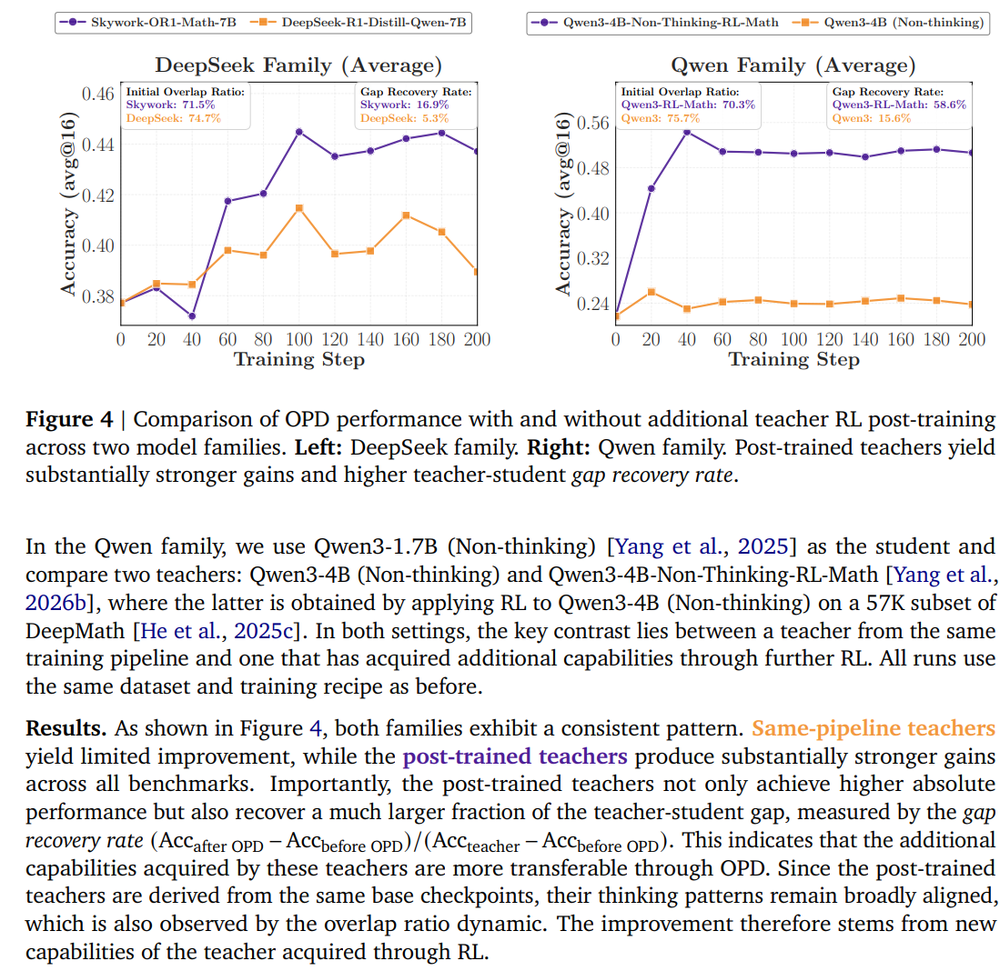
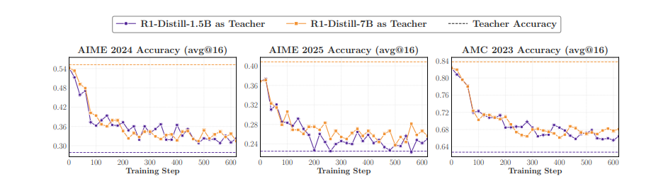
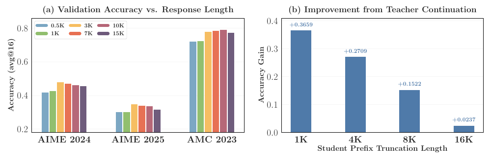
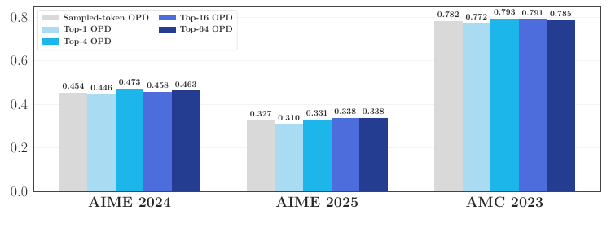
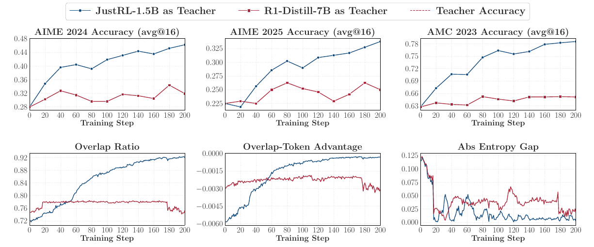
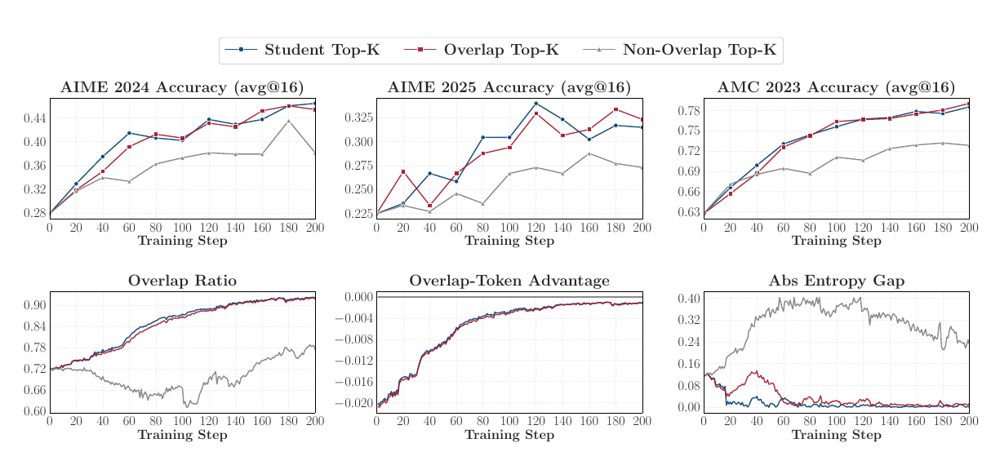
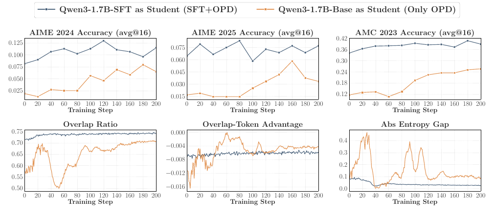
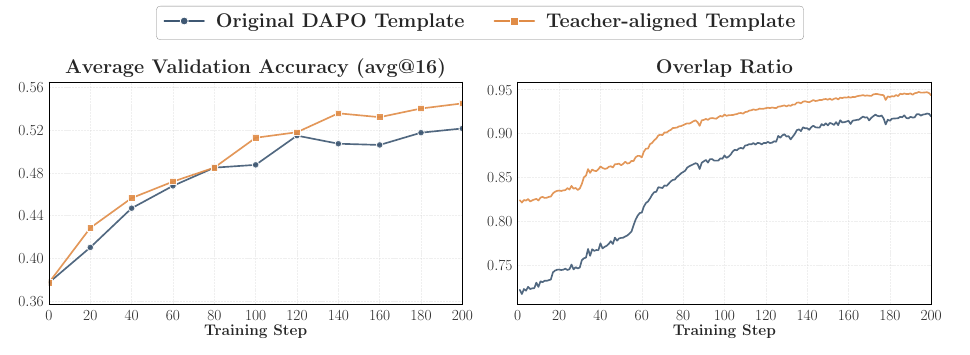

> **一句话结论：** OPD 是否有效，不由教师的参数量或 benchmark 分数单独决定，而取决于两件事：师生是否具有兼容的局部高概率分布，以及教师是否真的拥有学生尚未学到的能力。成功训练的直接机制，是在学生自己访问的状态上不断对齐师生共享的高概率 token。

这篇笔记只依据论文 v2 的[官方 PDF](https://arxiv.org/pdf/2604.13016)和[作者代码仓库](https://github.com/thunlp/OPD)整理。`[论文]` 表示作者报告的结论，`[分析]` 表示我基于论文证据做的归纳，`[假设]` 表示仍需实验验证的方向。这里的“thinking pattern”沿用论文术语，具体指师生在学生访问状态上的 top-$k$ token 分布兼容性，不把它扩大解释成完整的语义推理风格。

## 1. 现有方法及其缺陷：为什么还要重新研究 OPD？

### 从 off-policy 蒸馏到 on-policy 蒸馏

传统 off-policy Knowledge Distillation（KD）或 Supervised Fine-Tuning（SFT）让学生学习教师预先生成的固定序列。它的优点是简单稳定，但存在 **train–inference mismatch**：训练时学生沿着教师轨迹学习，推理时却必须沿自己的分布继续生成。一旦早期生成偏离教师轨迹，误差会在长序列中累积，这就是 exposure bias。[论文：PDF pp. 2, 18]

On-Policy Distillation（OPD）把监督位置换到了学生自己访问的状态：先由学生生成 rollout，再让教师对每个学生前缀给出逐 token 概率。这样既能缓解 exposure bias，又能获得比 outcome reward 更稠密的监督。

但更大或 benchmark 分数更高的教师，并不保证带来更好的蒸馏结果。论文因此把两个问题分开考察：教师是否具备学生未掌握的能力，以及学生当前的分布能否利用教师信号。[论文：PDF pp. 2, 5–8]

### 三种常见 OPD 实现也各有代价

| 方法 | 做法 | 优点 | 局限 |
|---|---|---|---|
| Sampled-Token OPD | 每个位置只使用学生实际采样的 token | 计算最轻；是 token-level reverse KL 的无偏单样本估计 | 单次监督不全面，低概率 token 的修正较慢；详见下方补充笔记 |
| Full-Vocabulary OPD | 每个位置计算全词表 KL | 监督最完整、梯度最密 | 内存开销为 $O(BTM)$，随 batch、长度和词表规模增长 |
| Top-$k$ OPD | 只在学生的 top-$k$ token 上计算重归一化 KL | 保留多 token 监督，同时降低教师查询成本 | 丢弃集合外概率质量，只是 full-vocabulary KL 的近似 |

**我的补充笔记：Sampled-Token OPD 的局限**

1. **监督信号不全面：** 单次采样只提供一个 Token 的误差信息，无法直接指导 Student 应该提高哪些 Token 的概率、降低哪些 Token 的概率，缺少完整的相对调整信息。
2. **低概率 Token 难以纠正：** 例如 Teacher 给“香蕉”35%，Student 仅给 5%，那么 Student 采到“香蕉”的概率很低，导致相关监督信号出现频率低、修正缓慢，需要更多采样才能充分学习。

所以，这篇论文真正追问的不是“OPD 能不能工作”，而是：

> **学生只会做自己熟悉的题。老师即使给出每个选项的完整评分，这些信息何时才能让学生进步？如果无效，问题出在教师能力、师生分布不兼容，还是训练方法没有利用好这些信息？**

## 2. 实验发现：什么决定 OPD 是否有效？

这一章先判断什么样的 Teacher 能教好 Student，再检查长轨迹、局部 reward 和 token 选择为什么会让 OPD 失效。

### 2.1 Teacher 自身不更强，为什么反而蒸馏得更好？

固定 Student（Qwen3-1.7B-Base）和训练数据（DAPO-Math-17K），只将 Teacher 替换为 Qwen3-4B（Non-thinking）或 Qwen3-4B-Base-GRPO。

**Figure 3 的意义：先比较两位 Teacher 自身的能力。**

*Figure 3（论文第 6 页）：两位 Teacher 在 AIME 2024、AIME 2025 和 AMC 2023 三个测试集上的原始准确率。*

**比较指标。** avg@16 可以简单理解为：同一道题让模型回答 16 次，再计算平均正确率。Figure 3 分别报告三个测试集的结果。

**图中现象。** GRPO Teacher 在 AIME 2024 和 AMC 2023 上更低，只在 AIME 2025 上更高，三项平均也略低。因此，后续蒸馏优势不能归因于 GRPO Teacher 自身分数更高。

**Figure 2 的意义：再比较 Student 的蒸馏结果与师生兼容性。**

*Figure 2（论文第 6 页）：紫线使用 GRPO Teacher，橙线使用 Non-thinking Teacher。*

**比较指标。** 左图是 Student 的平均验证准确率（avg@16），虚线表示对应 Teacher 的准确率。右图的 Overlap Ratio 表示师生最看好的 top-$k$ 个 token 中有多少相同，可以把它理解为两者当前的解题思路有多接近。

**图中现象。** GRPO Teacher 自身并不更强，但用它蒸馏的 Student 始终取得更高准确率，同时师生初始 Overlap Ratio 也更高。虽然两组 Overlap Ratio 在后期逐渐接近，Student 的性能差距仍然存在。

> **这个实验说明：Teacher 自己考分高，不代表更会教这个 Student。训练刚开始时，师生的思路越接近，Student 越容易用上 Teacher 给出的信息；如果一开始差得太远，后面即使 Overlap Ratio 追上来，前面丢掉的收益也可能补不回来。不过，这组实验只能说明“思路接近”和“学得更好”同时出现，不能证明它是唯一原因。**

[论文：PDF p. 6，Figs. 2–3]

### 2.2 兼容性还不够：Teacher 还需要提供新能力

**Figure 4 的意义：在师生已经比较“合拍”的情况下，进一步检查 Teacher 是否还要有 Student 没学过的新能力。**

*Figure 4（论文第 7 页）：左图为 DeepSeek 家族，右图为 Qwen 家族；紫线使用额外 RL Teacher，橙线使用同流水线 Teacher。*

论文在每个模型家族内固定 Student、OPD 数据和训练配置，只比较同流水线 Teacher 与经过额外 RL 的 Teacher。

**比较指标。**

- **Accuracy（avg@16）**：Student 实际做题的平均正确率；图中曲线汇总了三个测试集。
- **Initial Overlap Ratio**：训练开始时，师生最看好的 token 有多少相同。它回答的是“两者是否容易对上思路”。
- **Gap Recovery Rate**：Teacher 原本比 Student 高出的那段分数，Student 通过 OPD 追回了多少：

$$
\text{Gap Recovery Rate}
=\frac{\mathrm{Acc}_{\text{after OPD}}-\mathrm{Acc}_{\text{before OPD}}}
{\mathrm{Acc}_{\text{Teacher}}-\mathrm{Acc}_{\text{before OPD}}}.
$$

0% 表示 Student 完全没有追近 Teacher，100% 表示原来的性能差距被全部追回。

| 模型家族 | Teacher 类型 | Initial Overlap Ratio | Gap Recovery Rate |
|---|---|---:|---:|
| DeepSeek | 同流水线 Teacher | 74.7% | 5.3% |
| DeepSeek | 额外 RL Teacher | 71.5% | 16.9% |
| Qwen | 同流水线 Teacher | 75.7% | 15.6% |
| Qwen | 额外 RL Teacher | 70.3% | 58.6% |

**图中现象。** 两个额外 RL Teacher 的初始 Overlap Ratio 都略低，但 Student 的 avg@16 曲线和 Gap Recovery Rate 都明显更高。

> **这个实验说明：师生“对得上思路”只是 Student 能听懂 Teacher 的前提，不代表 Teacher 一定有新东西可教。想让 OPD 真正带来提升，Teacher 还要提供 Student 原本不会的能力。两个模型家族的结果都支持额外 RL 能带来这类新能力，但不能说明 RL 是唯一来源。**

[论文：PDF pp. 6–7，Fig. 4]

### 2.3 更大、更高分的 Teacher，为什么仍会让 Student 退化？

**Figure 5 的意义：检查 OPD 会保留 Student 后来通过 RL 学到的能力，还是会按照 Teacher 的方向把这些能力改掉。**

*Figure 5（论文第 8 页）：Student 为 JustRL-1.5B；紫线和橙线分别使用 R1-Distill-1.5B 与 R1-Distill-7B 作为 Teacher。*

JustRL-1.5B 由 R1-Distill-1.5B 继续 RL 得到。论文反过来使用它的 RL 前版本和同家族更大的 7B 模型作为 Teacher；两位 Teacher 都没有经历产生 JustRL-1.5B 的这段后续 RL 训练。

**比较指标。** 横轴是训练步数，纵轴是三个测试集上的 avg@16。紫、橙曲线表示 Student 在训练中的准确率，横向虚线表示对应 Teacher 自己的准确率。

**图中现象。** 两条曲线都从 JustRL-1.5B 的初始水平快速下降，最后停在近似的较低水平。R1-Distill-7B 的分数略高于当前 Student，R1-Distill-1.5B 则明显更弱，但两位 Teacher 最终都把 Student 往回拉了几乎同样的幅度。

> **这个实验说明：OPD 不会自动让 Student 变强，它做的事情是让 Student 的输出越来越像 Teacher。如果 Teacher 没有 Student 当前缺少的新能力，Student 反而可能被往回拉，丢掉后来通过 RL 得到的提升。1.5B 和 7B Teacher 带来了几乎相同的退化，只能说明它们在这些训练步骤上给出的方向很接近，不能说明两个模型整体完全相同。**

[论文：PDF pp. 7–8，Fig. 5]

### 2.4 轨迹不是越长越好：Teacher 的监督会随深度变差

**Figure 11 的意义：检查增加回答长度，是否一定能提供更多有效监督。** 左图比较最大回答长度为 0.5K、1K、3K、7K、10K 和 15K 时的 avg@16；右图先截取不同长度的 Student 前缀，再让 Teacher 继续作答，测量准确率能提高多少。

*Figure 11（论文第 14 页）：左图比较不同最大回答长度，右图比较 Teacher 从不同长度 Student 前缀继续生成时的准确率增益。*

**图中现象。** 0.5K 和 1K 太短，有效监督不足；3K 和 7K 效果最好；继续增加到 10K 和 15K，性能不再提高甚至下降。Teacher continuation 的增益也随 Student 前缀变长，从 1K 时的 **+0.3659** 降到 16K 时的 **+0.0237**。

原文的 Figures 12–13 进一步显示，10K/15K 训练会在后期出现 Overlap 下降、Entropy 和 Gradient Norm 尖峰；不稳定先从回答末尾出现，再逐渐向前传播。

> **这个实验说明：OPD 的轨迹不是越长越好。Student 生成得越远，前缀越可能离开 Teacher 熟悉的状态，后面的逐 token 监督会先变乱，最后影响整个训练。**

这一结论来自特定数学任务和模型组合，不能直接推断到所有长文本或多轮 Agent。[论文：PDF pp. 14–15，Figs. 11–13]

### 2.5 Teacher 有全局信息，为什么 OPD 仍会失败？

**Figure 14 的意义：检查失败 Teacher 的 reward 是否真的没有信息。** 固定同一个 Student，对比成功的 JustRL-1.5B Teacher 与失败的 R1-Distill-7B Teacher；再比较正确和错误 rollout 的 sequence mean reward 分布。

*Figure 14（论文第 16 页）：蓝色为正确 rollout，红色为错误 rollout；AUROC 衡量 reward 区分正确与错误的能力。*

**图中现象。** 两位 Teacher 都给正确 rollout 更高的平均 reward。成功 Teacher 的 AUROC 为 **0.7333**，失败 Teacher 反而达到 **0.7511**。因此，失败不能简单解释为“Teacher 的 reward 完全没有信息”。

> **这个实验说明：Teacher 能判断整道题答得好不好，不代表它给出的每一步修改方向都能推动 Student。全局 reward 有信息，局部训练信号仍可能无法利用。**

作者猜测，不同 token 位置的梯度方向可能互相抵消，但论文没有直接测量这些方向，因此这仍是假设，不能写成已经证明的原因。[论文：PDF pp. 15–16，Fig. 14]

### 2.6 监督 token 不是越多越好，关键是怎么选

**Figure 15 的意义：比较每个位置到底需要监督多少个 token。** 实验对比 Sampled-token OPD，以及 Top-1、Top-4、Top-16、Top-64 OPD；纵轴是三个测试集的 avg@16。

*Figure 15（论文第 17 页）：Sampled-token 与大多数 Top-$k$ 设置表现接近，Top-1 整体最弱。*

**Figure 16 的意义：解释 Top-1 为什么更差。**

*Figure 16（论文第 17 页）：Top-1 的 Overlap、Entropy 和 Gradient Norm 明显更不稳定；Top-16 与 Top-64 最平滑。*

**图中现象。** Sampled-token OPD 与 Top-$k$ 的最终准确率整体接近；从 Top-4 增加到 Top-16/64，提升很小但计算更贵。真正明显失败的是 Top-1，它始终只选择 argmax token，第一名稍有变化就会让监督信号剧烈波动。

> **这个实验说明：问题不在于“每次只监督一个 token”，而在于这个 token 怎么选。按 Student 概率随机采样，长期仍能覆盖主要候选；永远只盯 Top-1 反而容易不稳定。**

这只能说明该实验中增大 $k$ 的边际收益较小，不能推出所有任务都只需要 Sampled-token。[论文：PDF pp. 16–17，Figs. 15–16]

### 2.7 用人话总结：这些实验到底发现了什么？

| 图 | 看到的现象 | 最容易记住的结论 |
|---|---|---|
| Figures 2–3 | GRPO Teacher 自己分数不更高，却教出了更好的 Student | **老师自己考得好，不代表更会教这个 Student；训练开始时能否对上思路很重要** |
| Figure 4 | 额外 RL Teacher 的初始 Overlap 略低，却带来了更高的 Student 准确率和 Gap Recovery Rate | **能对上思路只是前提，Teacher 还得有 Student 没学过的东西** |
| Figure 5 | 1.5B 和更高分的 7B Teacher 都把 Student 拉到了近似的较低水平 | **OPD 不是只增不减；Teacher 没有新东西可教时，也可能把 Student 已有的 RL 提升带丢** |
| Figures 11–13 | 中等长度最好；轨迹过长后，训练从回答末尾开始失稳 | **稠密监督不是全程同样可靠，Student 走得越远，Teacher 的信号越容易失真** |
| Figure 14 | 失败 Teacher 的 reward 仍能区分正确与错误 rollout | **全局信号有信息，不等于局部梯度能被 Student 利用** |
| Figures 15–16 | Sampled-token 与 Top-$k$ 接近，Top-1 却明显更不稳定 | **监督 token 不是越多越好；选择方式比数量更重要** |

## 3. OPD 为什么有效，训练时怎么做？

这一章对应原文第四章，只看两张图：Figure 6 用来判断一次 OPD 是否正在有效学习；Figure 7 用来判断真正有用的训练信号来自哪些 token。

### 3.1 Figure 6：怎么判断 OPD 正在成功？

**图在比较什么。** 固定同一个 Student（R1-Distill-1.5B）和训练配置，只替换 Teacher。蓝线使用 JustRL-1.5B，是成功训练；红线使用整体分数略高的 R1-Distill-7B，但训练失败。

*Figure 6（论文第 9 页）：上排是三个测试集的 avg@16；下排依次是 Overlap Ratio、Overlap-Token Advantage 和 Abs Entropy Gap。*

**三个信号怎么读。**

- **Overlap Ratio 上升**：师生最看好的 token 越来越一致，也就是越来越“对得上思路”。
- **Overlap-Token Advantage 接近 0**：在双方都看好的 token 中，Student 分配的概率越来越接近 Teacher。
- **Entropy Gap 缩小**：师生对下一步有多确定，逐渐变得一致。

**图中现象。** 成功的蓝线在三个测试集上持续提高，最终追回了超过 80% 的师生性能差距；下方三个指标也同时向好的方向变化。失败的红线几乎没有性能提升，三个指标从训练前期就基本停滞。

> **说人话：成功的 OPD 会出现三个同步信号——Overlap 上升、Advantage 靠近 0、Entropy Gap 缩小。如果三个指标很早就不动了，只增加训练步数通常不够。**

Figure 6 给出的是诊断信号，不能单独证明其中某一个指标就是成功的充分原因。[论文：PDF pp. 8–9，Fig. 6]

### 3.2 Figure 7：真正应该优化哪些 token？

**图在比较什么。** 在同一次成功 OPD 中，只改变 loss 覆盖的 token：

- **Student Top-$k$**：优化 Student 最看好的全部 $k$ 个 token；
- **Overlap Top-$k$**：只优化师生共同看好的 token；
- **Non-Overlap Top-$k$**：只优化双方不重合的 token。

论文默认 $k=16$。

*Figure 7（论文第 10 页）：蓝线为完整 Student Top-$k$，红线为 Overlap Top-$k$，灰线为 Non-Overlap Top-$k$。*

**图中现象。** 红线几乎复现了蓝线的准确率和训练动态；灰线在三个测试集上都明显更弱。Student Top-$k$ 与 Overlap Top-$k$ 都让 Overlap Ratio 从约 72% 升到 91% 以上，而 Non-Overlap Top-$k$ 只恢复了一部分。原文还指出，共同 token 虽然数量不多，却承载师生 **97%–99%** 的总概率质量。

> **说人话：OPD 主要不是把 Student 强行拉向它完全没考虑过的 token，而是在师生原本都觉得“有可能”的答案中重新分配概率。**

Figure 7 说明 overlap 区域在这组数学任务和 $k=16$ 设置中是主要作用位置，但不能推出 non-overlap token 在所有任务中都没有价值。[论文：PDF pp. 9–10，Fig. 7]

### 3.3 实际训练时，我们应该怎么做？

| 训练中看到的信号 | 说明什么 | 应该怎么做 |
|---|---|---|
| Overlap 上升、Advantage 接近 0、Entropy Gap 缩小 | Student 正在逐步用上 Teacher 的信号 | 继续训练，并同步观察验证集准确率 |
| 三个指标从前期就长期停滞 | 当前 Teacher 的信号很难被 Student 利用 | 不要只增加训练步数；优先尝试 cold start、Teacher-aligned prompts，或重新选择 Teacher |
| Overlap-only 接近完整 Top-$k$ | 主要收益来自师生共享的高概率 token | 保留 Student Top-$k$ 作为稳妥基线；做机制优化时优先关注 overlap 区域 |
| Non-overlap-only 明显更弱 | 强行学习完全不重合的 token 效率较低 | 先缩小师生思考模式差距，再进行 OPD |

需要注意：cold start 和 prompt 对齐只能让 Teacher 的信号更容易被 Student 使用，不能凭空让 Teacher 获得新的知识。

## 4. 文章的方法：从目标函数到 token 级机制

### 4.1 OPD 的基本目标

给定 prompt $x$，学生策略 $\pi_\theta$ 生成 rollout
$\hat y=(\hat y_1,\ldots,\hat y_T)\sim\pi_\theta(\cdot\mid x)$。在学生已经生成的前缀 $(x,\hat y_{<t})$ 上，定义：

$$
p_t(v)=\pi_\theta(v\mid x,\hat y_{<t}),\qquad
q_t(v)=\pi_T(v\mid x,\hat y_{<t}),
$$

其中 $p_t$ 是学生的 next-token 分布，$q_t$ 是教师在**同一个学生前缀**上的分布。

标准 OPD 最小化学生到教师的 reverse KL 再利用自回归分解，它可以精确写成学生访问状态上的 token-level KL：

$$
\mathcal L_{\mathrm{OPD}}(\theta)
=\mathbb E_{x,\hat y\sim\pi_\theta}
\left[
\sum_{t=1}^{T}D_{\mathrm{KL}}(p_t\Vert q_t)
\right].
$$

Top-$k$ OPD 取学生高概率集合 $S_t=\operatorname{TopK}(p_t,k)$，先在集合内重归一化：

$$
\bar p_t^{(S_t)}(v)
=\frac{p_t(v)\mathbf 1[v\in S_t]}{\sum_{u\in S_t}p_t(u)},
\qquad
\bar q_t^{(S_t)}(v)
=\frac{q_t(v)\mathbf 1[v\in S_t]}{\sum_{u\in S_t}q_t(u)},
$$

再最小化 $D_{\mathrm{KL}}(\bar p_t^{(S_t)}\Vert\bar q_t^{(S_t)})$。论文的大部分机制实验使用这一形式。[论文：PDF p. 4，Eq. 5]

### 4.2 三个动态指标：判断教师信号是否真的可学

令学生和教师的 top-$k$ 集合分别为
$S_t^{(p)}=\operatorname{TopK}(p_t,k)$ 与
$S_t^{(q)}=\operatorname{TopK}(q_t,k)$。

**1）Overlap Ratio：师生是否在关注相同候选。**

$$
\mathcal M_{\mathrm{overlap}}
=\mathbb E_t\left[
\frac{|S_t^{(p)}\cap S_t^{(q)}|}{k}
\right].
$$

值越高，说明学生越接近教师的高概率 support region；低值表示两者存在明显 mode mismatch。[论文：PDF p. 4，Eq. 6]

**2）Overlap-Token Advantage：共享 token 内的概率是否一致。**

令 $C_t=S_t^{(p)}\cap S_t^{(q)}$。在 $C_t\neq\varnothing$ 的位置，把师生分布限制在 $C_t$ 内重新归一化为 $\bar p_t$ 与 $\bar q_t$。对任一共享 token $v$，定义：

$$
A_t(v)=\bar p_t(v)
\bigl(\log\bar q_t(v)-\log\bar p_t(v)\bigr)
$$

它用学生概率加权师生的对数概率差，表示该 token 对整体分布差异的贡献：

| $A_t(v)$ | 概率关系 | 说明 |
|---|---|---|
| 正数 | $\bar q_t(v)>\bar p_t(v)$ | 学生相对低估该 token |
| 负数 | $\bar p_t(v)>\bar q_t(v)$ | 学生相对高估该 token |
| 0 | $\bar p_t(v)=\bar q_t(v)$ | 双方概率一致 |

再对共享 token 和生成位置求平均：

$$
\mathcal M_{\mathrm{adv}}
=\mathbb E_t\left[
\frac{1}{|C_t|}
\sum_{v\in C_t}A_t(v)
\right]
$$

由于 $\sum_{v\in C_t}A_t(v)=-D_{\mathrm{KL}}(\bar p_t\Vert\bar q_t)\leq 0$，所以 $\mathcal M_{\mathrm{adv}}$ 越接近 0，师生在共享集合内的概率分配越一致；越负，平均每个共享 token 的分布差异越大。单个 $A_t(v)$ 可以为正或负，但聚合指标不会大于 0。

**局限性：** 该指标必须与 overlap ratio 一起看。若交集只有一个 token，重归一化后 $\mathcal M_{\mathrm{adv}}$ 必然为 0，即使双方的原始概率不同。

[论文：PDF p. 5，Eq. 7]

**3）Entropy Gap：师生置信度结构是否一致。**

$$
\Delta H_t=|H(q_t)-H(p_t)|.
$$

趋近 0 表示两者在相同学生状态上的不确定性结构逐渐匹配。[论文：PDF p. 5，Eq. 8]

### 4.3 方法的完整逻辑

论文先通过教师对照与 reverse distillation 识别 OPD 的两个成功条件（局部分布兼容、教师提供新能力），再用 overlap ratio、overlap-token advantage 和 entropy gap 跟踪训练动态，并通过 overlap-only / non-overlap-only 干预定位主要优化区域。最后，作者从模型初始化和数据选择两侧给出两条恢复 recipe：

- **Off-policy cold start**：先用教师生成的 rollout 对学生做一段 SFT，再切换到 OPD；
- **Teacher-aligned prompt selection**：使用与教师 post-training 更一致的 prompt 模板或内容进行 OPD。

[论文：PDF pp. 5–14]

## 5. 原文第五章：怎样修复失败的 OPD？

原文没有修改 OPD 的 loss，而是从两个地方缩小师生差距：先改变 Student 的起点，或者让训练 prompts 更贴近 Teacher。

### 5.1 实验一：先做 SFT cold start，再做 OPD

**怎么做。** Teacher 先生成 200K 条回答，用这些回答对 Qwen3-1.7B-Base 做 SFT；然后再使用约 30K 条去重 prompts 进行 OPD。

**图在比较什么。** 两组使用相同的 Teacher（Qwen3-4B Non-thinking）和相同的 OPD prompts，只比较：

- **SFT + OPD**：Student 先学习 Teacher 的完整回答，再做 OPD；
- **Only OPD**：Student 从 Base 模型直接开始 OPD。

指标包括三个测试集的 Accuracy（avg@16）、Overlap Ratio、Overlap-Token Advantage 和 Entropy Gap。

*Figure 8（论文第 12 页）：蓝线为 SFT + OPD，橙线为直接 OPD。*

**看到什么。** SFT + OPD 在三个测试集上始终更好，而且优势保持到训练结束。它从一开始就有更高、更稳定的 Overlap Ratio，Entropy Gap 也更小；直接 OPD 的训练则明显更不稳定。

> **说人话：如果 Student 一开始听不懂 Teacher，就先让它模仿一批 Teacher 的完整解题过程，再进入 OPD。这样 Teacher 的 token 级信号从训练开始就更容易被利用。**

这组实验只验证了一组 Qwen 模型和数学任务；SFT 本身也可能提高 Student 的能力，因此不能把全部收益都归因于 overlap 提高。[论文：PDF pp. 11–12，Fig. 8]

### 5.2 实验二：使用 Teacher 更熟悉的 prompts

这个实验从数据侧做对齐，分别检查 **prompt 模板** 和 **prompt 内容**。

**（1）只对齐 prompt 模板。** 两组使用完全相同的数学题，只改变提问格式：原始 DAPO 模板，或 Teacher post-training 时使用的模板。

*Figure 9（论文第 13 页）：Teacher-aligned 模板带来更高的验证准确率和 Overlap Ratio。*

因为题目内容没有变化，这张图说明：**仅仅把问题改成 Teacher 熟悉的表达方式，就能让师生更容易“对上思路”。**

**（2）对齐 prompt 内容。** 原文比较 Teacher 做 RL 时见过的 DAPO-Math-17K，与去重后的 DeepMath prompts。指标包括三个测试集的 Accuracy、Overlap Ratio、overlap tokens 承载的概率质量和 Student Entropy。

*Figure 10（论文第 13 页）：橙线使用 Teacher post-training prompts，蓝线使用去重后的同领域 prompts。*

**看到什么。** Teacher 熟悉的 prompts 带来更高的准确率。虽然它的 Overlap Ratio 更低，但 Student 放在 overlap tokens 上的总概率更高，说明少量共同 token 承载了更集中的信号；与此同时，Student Entropy 明显下降。

> **说人话：选择 Teacher 熟悉的模板和数据，确实能让 OPD 更有效；但如果只用 Teacher 见过的数据，Student 可能过早变得过于确定。实际训练时应混入一部分 Teacher 没见过的 prompts，保留探索能力。**

[论文：PDF pp. 12–13，Figs. 9–10]

| 遇到的问题 | 应该怎么做 |
|---|---|
| Student 与 Teacher 一开始差得太远 | 先用 Teacher responses 做 SFT cold start，再进入 OPD |
| Prompt 的格式或内容与 Teacher 训练分布不一致 | 使用 Teacher-aligned prompts，同时混入 Teacher 未见过的 prompts |

## 6. 现有方法的弊端与未来方向

### 6.1 作者明确指出的局限

**1）证据范围局限于数学推理。**

论文的模型、数据和评测集中在 AIME、AMC 等数学任务，尚不能直接推断到代码生成、开放式任务或多轮 agent。[论文：PDF p. 19]

**2）“新知识”的来源仍未被完全隔离。**

论文用额外 RL 后的教师作为新能力来源，但 pre-training 数据差异、tokenizer、架构、post-training 数据与目标可能纠缠。作者指出，受控 pre-training ablation 成本很高，这仍是开放问题。[论文：PDF p. 19]

**3）在本文设置中，长轨迹会削弱稠密监督的可靠性。**

具体实验见 2.4；目前证据集中在数学任务和一个模型组合，能否推广到长文本生成和多轮 Agent 仍需验证。[论文：PDF pp. 14–16，Figs. 11–13]

**4）Prompt 对齐可能压缩探索能力。**

使用教师 post-training prompts 会显著降低学生 entropy。作者建议混入教师分布之外的 prompts，避免过度压缩学生的探索空间。[论文：PDF pp. 13–14，Fig. 10]

**5）局部梯度几何仍只是一个假设。**

2.5 展示了“全局 reward 有信息但 OPD 仍失败”的现象；作者提出的 per-token 梯度相互抵消解释尚未被直接验证。[论文：PDF pp. 15–16，Fig. 14]

**6）Self-distillation 仍需单独验证。**

单模型自蒸馏天然具有更高 pattern consistency，新能力往往来自 privileged information。论文的两条件框架能否直接迁移到该 setting，作者认为仍是下一步问题。[论文：PDF p. 19]

### 6.2 作者提出的未来方向

- 在代码、开放式生成和其他非数学领域验证“两条件 + 高概率 token 对齐”是否仍成立；
- 研究 pre-training 数据对 OPD 可蒸馏性的独立影响；
- 扩展到 self-distillation，分析 privileged information 如何构成新能力；
- 对长程推理采用混合方案：短 horizon 使用稠密 token 监督，长 horizon 使用稀疏 outcome reward；或用 curriculum 逐步延长监督长度；
- 直接分析 per-token 梯度方向，设计能利用 anisotropic reward structure 的新目标。

[论文：PDF pp. 16–17, 19]

### 6.3 基于论文证据，我认为值得继续验证的方向

下面不是作者已经证明的结论，而是从现有证据推出的研究假设。

| 观察 | `[假设]` 可验证方向 | 最小验证方式 |
|---|---|---|
| 论文用 top-$k$ overlap 操作化 thinking pattern | 它预测的是局部分布兼容性，不一定等价于语义层面的推理风格 | 固定 tokenizer 和正确答案，构造不同推理路径，检查 overlap 是否仍能预测 OPD 成败 |
| 额外 RL 同时改变数据、目标和训练步数 | “新能力”的可迁移性可能来自其中某一因素，而非 RL 本身 | 固定基座与总预算，对数据、reward objective、steps 做正交消融 |
| Cold start 使用 200K 教师 rollout | 它有效，但 compute-normalized 性价比尚不清楚 | 固定教师 token、训练 FLOPs 和 wall-clock，搜索达到目标 overlap 的最低 cold-start 预算 |
| Overlap token 数量与 overlap probability mass 可能不一致 | 单独用 overlap ratio 选教师或 prompt 可能误判 | 联合 overlap mass、entropy gap 与 gradient coherence，预测最终 gap recovery |
| 证据集中在 Qwen/DeepSeek 衍生模型和数学任务 | 两个成功条件可能受 tokenizer、架构和任务类型影响 | 做跨 tokenizer、跨架构、代码与多轮 agent 的矩阵实验 |

我最想保留的研究问题是：**能否只用训练最初 10–20 步的 overlap mass、entropy gap 和 gradient coherence，提前判断某个 teacher–student pair 是否值得继续蒸馏？** 如果能，就可以在完整训练之前做一次低成本“可蒸馏性体检”，把论文的事后机制分析变成事前选择工具。
