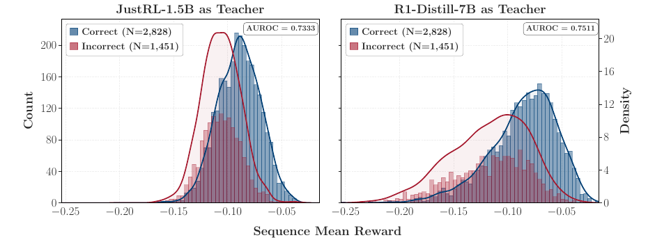
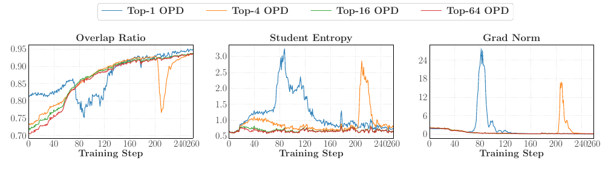
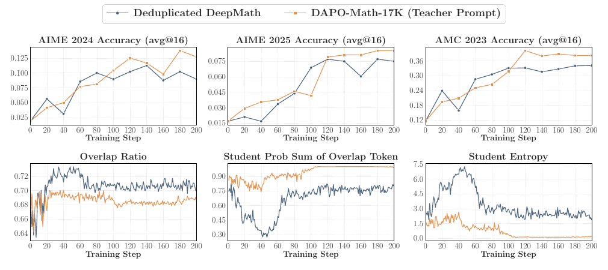

> **一句话结论：** 在本文实验设置中，OPD 能否成功主要受两个条件制约：学生能否利用教师当前给出的信号，以及教师是否确实拥有学生尚未学到的能力。训练真正起作用的位置，是师生共同认可的高概率 token。

> **阅读路线：** 先看 OPD 为什么会失败，再看两个成功条件、token 级机制、修复方法，最后明确结论的适用边界。

这篇笔记依据论文 v2 的[官方 PDF](https://arxiv.org/pdf/2604.13016)和[作者代码仓库](https://github.com/thunlp/OPD)整理。本文把 Teacher 和 Student 统一写作“教师”和“学生”。原文主要用学生访问状态上的 top-$k$ token overlap 来近似刻画 thinking-pattern compatibility；它反映的是**局部分布兼容性**，不等同于完整的语义推理风格。

## 1. OPD 的动机与核心问题

### 1.1 从教师轨迹到学生访问状态

传统 off-policy Knowledge Distillation（KD）或 Supervised Fine-Tuning（SFT）让学生学习教师预先生成的固定序列。它简单稳定，但训练时学生沿着教师轨迹学习，推理时却必须沿自己的分布继续生成。只要早期生成发生偏离，后续状态就可能越来越陌生，这就是 exposure bias。

On-Policy Distillation（OPD）改用学生自己生成的 rollout（轨迹）：学生先回答，教师再对每个学生前缀给出逐 token 概率。这样既减轻了 train–inference mismatch，又比只看最终答案对错的 outcome reward 提供更稠密的监督。[论文：PDF pp. 2–3, 18]

### 1.2 三种 OPD 实现的监督范围

| 实现 | 每个位置如何计算监督 | 主要特点 |
|---|---|---|
| Sampled-token OPD | 只使用学生按自身概率采样到的一个 token | 计算最轻，是 token-level KL 的无偏单样本估计；单步信息少，但长期能够覆盖高概率区域 |
| Full-vocabulary OPD | 对整个词表计算 KL | 监督最完整，但内存开销随 batch、序列长度和词表大小增长 |
| Top-$k$ OPD | 只在学生最高概率的 $k$ 个 token 上计算重归一化 KL | 在计算量和多 token 监督之间折中，但只是 full-vocabulary KL 的近似 |

论文后面的实验会说明：在本文设置中，Sampled-token 并不弱；真正容易不稳定的是始终只选 argmax 的 Top-1。[论文：PDF pp. 3–4, 16–17，Figs. 15–16]

### 1.3 两个关键条件：教师有新能力，学生能利用

OPD 已经给了学生逐 token 的稠密信号，但论文仍观察到一个反常现象：更大、基准分数更高的教师，可能完全无法改善学生；较弱的教师反而能成功。

因此，全文实际在回答两个不同的问题：

1. **信息增益：** 教师是否拥有学生尚未获得的能力？
2. **局部可利用性：** 在学生当前访问的状态上，教师信号是否与学生足够兼容？

## 2. OPD 的成功条件与失效模式

论文主要在 AIME 2024、AIME 2025 和 AMC 2023 上评测。avg@16 表示每道题采样 16 次后得到的平均正确率。

### 2.1 条件一：师生局部分布兼容

论文固定学生 Qwen3-1.7B-Base 和训练数据 DAPO-Math-17K，只替换教师：Qwen3-4B（Non-thinking）或 Qwen3-4B-Base-GRPO。

先看两位教师自己的能力：

*Figure 3（论文第 6 页）：两位教师在三个数学测试集上的原始准确率。*

GRPO 教师在 AIME 2024 和 AMC 2023 上更低，只在 AIME 2025 上更高，三项平均也略低。因此，后续蒸馏差异不能归因于 GRPO 教师自身分数更高。

再看学生的训练结果：

*Figure 2（论文第 6 页）：左图是学生 avg@16，右图是师生 Overlap Ratio；紫线使用 GRPO 教师，橙线使用 Non-thinking 教师。*

Overlap Ratio 统计师生 top-$k$ 候选 token 中有多少相同，可以把它理解为“当前这一步是否关注相似的候选”。GRPO 教师虽然自身并不更强，却具有更高的初始 Overlap Ratio，并且教出了更好的学生。后期两组 Overlap Ratio 逐渐接近，早期形成的性能差距却没有消失。

> **结论：教师自己考得好，不代表更会教这个学生。训练开始时能否在局部高概率候选上“对上思路”，会影响教师信号能否被及时利用。**

这组实验显示兼容性与更好结果同时出现，但不能单独证明兼容性是唯一原因。[论文：PDF pp. 5–6，Figs. 2–3]

### 2.2 条件二：教师提供新能力

Figure 4 在 DeepSeek 和 Qwen 两个模型家族中，分别比较同流水线教师与经过额外 RL 的教师。

*Figure 4（论文第 7 页）：紫线使用额外 RL 教师，橙线使用同流水线教师。*

这里需要同时看三个量：

- **Accuracy（avg@16）**：学生最终做题能力；
- **Initial Overlap Ratio**：训练开始时的局部分布兼容性；
- **Gap Recovery Rate**：教师原本领先学生的性能差距，被 OPD 追回了多少。

| 模型家族 | 教师类型 | Initial Overlap Ratio | Gap Recovery Rate |
|---|---|---:|---:|
| DeepSeek | 同流水线教师 | 74.7% | 5.3% |
| DeepSeek | 额外 RL 教师 | 71.5% | 16.9% |
| Qwen | 同流水线教师 | 75.7% | 15.6% |
| Qwen | 额外 RL 教师 | 70.3% | 58.6% |

两位额外 RL 教师的初始 Overlap Ratio 都略低，最终却带来更高的学生准确率和 Gap Recovery Rate。这说明兼容性只回答“信号能否被利用”，不回答“信号里有没有新东西”。

为了进一步区分教师分数与可迁移能力，论文做了反向蒸馏：

*Figure 5（论文第 8 页）：学生为经过后续 RL 的 JustRL-1.5B；两位教师都没有经历这段 RL。*

无论使用 R1-Distill-1.5B，还是基准分数略高的 R1-Distill-7B，学生都迅速退化到近似的较低水平。OPD 并不会自动“取教师和学生各自最好的一面”，而是持续把学生分布拉向教师。

> **结论：教师必须同时满足两个条件——与学生局部兼容，并且拥有学生尚未获得的能力。缺少前者，信号难以利用；缺少后者，学生没有净收益，甚至会丢掉已有能力。**

在本文的两个受控模型家族中，作者把 post-trained 教师的额外收益归因于进一步 RL 获得的能力；这不能推出 RL 是新能力的唯一来源。[论文：PDF pp. 6–8，Figs. 4–5]

### 2.3 失效一：长轨迹削弱监督可靠性

Figure 11 检查增加回答长度是否一定能带来更多有效监督。左图比较 0.5K、1K、3K、7K、10K 和 15K 的最大回答长度；右图先截取不同长度的学生前缀，再让教师继续生成。

*Figure 11（论文第 14 页）：左图比较不同最大回答长度，右图显示教师从不同长度学生前缀继续生成时的准确率增益。*

0.5K 和 1K 太短，监督 token 不足；3K 和 7K 效果最好；继续增加到 10K 和 15K，性能不再提高甚至下降。教师 continuation 的增益也从 1K 前缀时的 **+0.3659** 降到 16K 时的 **+0.0237**。

Figures 12–13 进一步显示，10K/15K 训练在后期出现 Overlap 下降、Entropy 和 Gradient Norm 尖峰；不稳定先从回答末尾出现，再逐渐向前传播。

> **结论：学生生成得越远，前缀越可能离开教师熟悉的状态。OPD 的稠密监督并非全程同样可靠，过长轨迹会先让末尾信号变乱，再影响整体训练。**

这一结论来自特定数学任务和模型组合，不能直接推广到所有长文本或多轮 Agent。[论文：PDF pp. 14–15，Figs. 11–13]

### 2.4 失效二：会判断答案，不等于会指导

Figure 14 固定同一个学生，对比成功的 JustRL-1.5B 教师与失败的 R1-Distill-7B 教师，并检查两者的 sequence mean reward 能否区分正确和错误 rollout。Sequence mean reward 是一条回答中各 token 的 $\log\pi_T-\log\pi_\theta$ 的平均值，可以理解为：沿着这条学生轨迹，教师相对学生有多偏好这些已生成 token。

*Figure 14（论文第 16 页）：蓝色为正确 rollout，红色为错误 rollout；AUROC 衡量 reward 区分两者的能力。*

成功教师的 AUROC 为 **0.7333**，失败教师反而达到 **0.7511**。也就是说，失败教师的全局 reward 并不更差，它仍能区分整道题答得好不好。

> **结论：教师能给完整答案排出好坏，不代表这些逐 token 信号一定能形成有效更新。全局 reward 有信息，仍不保证局部可优化。**

作者提出一种尚未验证的解释：不同 token 位置的梯度方向可能互相抵消。论文没有直接测量 per-token gradient direction，因此这仍是假设。[论文：PDF pp. 15–16，Fig. 14]

### 2.5 实现选择：token 选择比数量更重要

Figure 15 比较 Sampled-token OPD 与 Top-1、Top-4、Top-16、Top-64 OPD 的最终准确率。

*Figure 15（论文第 17 页）：Sampled-token 与大多数 Top-$k$ 设置接近，Top-1 整体最弱。*

Figure 16 进一步比较不同 Top-$k$ 设置的训练动态：

*Figure 16（论文第 17 页）：Top-1 的 Overlap、Entropy 和 Gradient Norm 明显更不稳定；Top-16 与 Top-64 最平滑。*

从 Top-4 增加到 Top-16/64，最终准确率提升很小，但计算更贵。真正明显失败的是 Top-1：它始终只选择 argmax token，第一名稍有变化，监督信号就会剧烈波动。

> **结论：问题不在于“每次只监督一个 token”，而在于 token 怎么选。按学生概率随机采样，长期能够无偏覆盖高概率区域；永远只盯 Top-1 反而容易不稳定。**

这只能说明本文设置中增大 $k$ 的边际收益较小，不能推出所有任务都只需要 Sampled-token。[论文：PDF pp. 16–17，Figs. 15–16]

### 2.6 实验结论汇总

| 问题 | 关键证据 | 最容易记住的结论 |
|---|---|---|
| 什么样的教师更适合当前学生？ | Figures 2–3 | 教师分数不是关键；初始局部分布兼容性很重要 |
| 兼容是否已经足够？ | Figures 4–5 | 还不够；教师必须提供学生尚未获得的能力 |
| 轨迹是否越长越好？ | Figures 11–13 | 存在合适长度；过长后监督可靠性下降 |
| 全局 reward 有信息是否等于 OPD 能成功？ | Figure 14 | 不等于；全局可区分不保证局部可优化 |
| 每一步监督的 token 是否越多越好？ | Figures 15–16 | 不一定；选择规则比数量更关键 |

## 3. OPD 的 token 级作用机制

第二章给出了两个成功条件，并展示了两类失效模式和一种实现取舍。本章先聚焦成功条件，解释 OPD 在 token 层面如何形成持续增益。

### 3.1 OPD 的优化目标

给定 prompt $x$，学生策略 $\pi_\theta$ 生成轨迹
$\hat y\sim\pi_\theta(\cdot\mid x)$。在同一个学生前缀 $(x,\hat y_{<t})$ 上，定义学生和教师的 next-token 分布：

$$
p_t(v)=\pi_\theta(v\mid x,\hat y_{<t}),\qquad
q_t(v)=\pi_T(v\mid x,\hat y_{<t}).
$$

说得直白一些，OPD 就是在学生实际走到的每个前缀上，让学生的下一步概率分布逐渐靠近教师。标准 OPD 最小化学生到教师的 reverse KL，并可以精确分解为学生访问状态上的 token-level KL：

$$
\mathcal L_{\mathrm{OPD}}(\theta)
=\mathbb E_{x,\hat y\sim\pi_\theta}
\left[
\sum_{t=1}^{T}D_{\mathrm{KL}}(p_t\Vert q_t)
\right].
$$

Top-$k$ OPD 只取学生最高概率集合 $S_t=\operatorname{TopK}(p_t,k)$，把师生分布在该集合内重新归一化，再计算 KL。它降低了教师查询成本，但忽略了集合外的概率质量。[论文：PDF pp. 3–4，Eqs. 2, 5]

### 3.2 三个动态指标及其含义

令学生和教师的 top-$k$ 集合为 $S_t^{(p)}$ 与 $S_t^{(q)}$，交集为 $C_t=S_t^{(p)}\cap S_t^{(q)}$。

| 指标 | 回答的问题 | 成功训练中的典型趋势 |
|---|---|---|
| Overlap Ratio | 师生是否关注相同的高概率候选？ | 上升 |
| Overlap-Token Advantage | 在共同候选中，双方概率分配是否接近？ | 向 0 靠近 |
| Entropy Gap | 师生对下一步有多确定，是否一致？ | 缩小 |

如果只想理解后续图片，记住上表即可；下面的公式用于精确定义这三个指标。

**Overlap Ratio**

$$
\mathcal M_{\mathrm{overlap}}
=\mathbb E_t\left[
\frac{|S_t^{(p)}\cap S_t^{(q)}|}{k}
\right].
$$

它数的是“共同 token 有多少”，越高表示局部候选空间越接近。

**Overlap-Token Advantage**

把师生分布限制在 $C_t$ 内并重新归一化为 $\bar p_t$ 与 $\bar q_t$：

$$
\mathcal M_{\mathrm{adv}}
=\mathbb E_t\left[
\frac{1}{|C_t|}
\sum_{v\in C_t}
\bar p_t(v)\bigl(\log\bar q_t(v)-\log\bar p_t(v)\bigr)
\right].
$$

这个指标本质上是共享 token 集合内 KL 的负值，因此不会大于 0。阅读时只需看它离 0 有多远：越接近 0，师生在共同候选中的概率分配越一致。它必须与 Overlap Ratio 一起看；如果交集只有一个 token，重归一化后该指标也会等于 0。

**Entropy Gap**

$$
\Delta H_t=|H(q_t)-H(p_t)|.
$$

它衡量师生在同一学生状态上的置信度差异，越小表示不确定性结构越接近。[论文：PDF pp. 4–5，Eqs. 6–8]

还要区分 **Overlap Ratio** 与 **Overlap Mass**：前者数共同 token 的数量，后者看学生或教师有多少概率落在这些 token 上。共同 token 数量少，不代表它们不重要。

### 3.3 Figure 6：成功与失败的训练动态

论文固定学生 R1-Distill-1.5B 和训练配置，只替换教师。JustRL-1.5B 能成功提升学生；R1-Distill-7B 虽然基准分数高于学生，却没有带来提升。

*Figure 6（论文第 9 页）：上排是三个测试集的 avg@16；下排依次是 Overlap Ratio、Overlap-Token Advantage 和 Abs Entropy Gap。*

成功训练的学生在三个测试集上持续提高，最终追回超过 80% 的师生性能差距；同时 Overlap 上升、Advantage 向 0 靠近、Entropy Gap 缩小。失败训练几乎没有性能提升，三个动态指标也从前期开始停滞。

> **诊断信号：如果三个指标同步改善，学生正在逐步用上教师信号；如果它们很早就停滞，只增加训练步数通常不够。**

Figure 6 给出的是成功与失败的动态特征，不能单独证明其中某一个指标是成功的充分原因。[论文：PDF pp. 8–9，Fig. 6]

### 3.4 Figure 7：有效监督来自共享 token

论文在同一次成功 OPD 中，只改变 loss 覆盖的 token：

- **Student Top-$k$**：优化学生最高概率的全部 $k$ 个 token；
- **Overlap Top-$k$**：只优化师生共同的高概率 token；
- **Non-Overlap Top-$k$**：只优化双方不重合的 token。

*Figure 7（论文第 10 页）：蓝线为 Student Top-$k$，红线为 Overlap Top-$k$，灰线为 Non-Overlap Top-$k$；默认 $k=16$。*

Overlap Top-$k$ 几乎复现了完整 Student Top-$k$ 的准确率和训练动态，Non-Overlap Top-$k$ 则明显更弱。前两者都让 Overlap Ratio 从约 72% 上升到 91% 以上。

共同 token 的数量并不多，但学生和教师各自都有约 **97%–99%** 的概率质量落在这些 token 上。因此，OPD 主要不是把学生强行拉向它完全没考虑过的 token，而是在双方都认为“有可能”的候选中重新分配概率。

Figure 7 提供了比 Figure 6 更强的干预证据，但结论仍限于本文数学任务和 $k=16$ 设置，不能推出 non-overlap token 在所有任务中都没有价值。[论文：PDF pp. 9–10，Fig. 7；Appendix B.1]

### 3.5 完整机制链

> **教师有学生尚未获得的能力** 
> ＋ **学生能够进入教师支持的高概率区域** 
> → reverse-KL 把更多概率放到教师偏好的共同 token 
> → 共同区域扩大，概率分配与置信度逐步接近 
> → 教师信号越来越容易被学生利用 
> → 在本文成功设置中，学生性能持续提高

这里形成了全文的逻辑闭环：

- **没有新能力：** 即使师生很兼容，也缺少信息增益；
- **局部不兼容：** 即使教师更强，训练的自增强循环也启动不了；
- **两者同时满足：** 训练具备启动共享高概率对齐的基础；能否持续推进，还取决于轨迹长度和 token 选择等训练条件。

## 4. OPD 失败的修复方法

两条 recipe 都在修复“局部可利用性”，而不是修改 OPD loss 或凭空给教师创造新知识。

### 4.1 起点不兼容：先 SFT，再 OPD

教师先在 OpenThoughts 数学子集上生成 200K 条回答，用这些 rollout 对 Qwen3-1.7B-Base 做 SFT；随后再使用约 30K 条去重 prompts 进行 OPD。对照组使用相同教师和相同 OPD prompts，但直接从 Base 学生开始。

*Figure 8（论文第 12 页）：蓝线为 SFT + OPD，橙线为直接 OPD。*

SFT + OPD 在三个测试集上始终更好，而且优势保持到训练结束。它从一开始就有更高、更稳定的 Overlap Ratio，Entropy Gap 也更小；直接 OPD 则明显更不稳定。

> **怎么用：如果学生一开始听不懂教师，先让它模仿一批教师的完整回答，再进入 OPD。这样逐 token 信号从训练开始就更容易被利用。**

需要保留一个解释边界：SFT 本身也可能提高学生能力，因此这项对照不能把全部收益唯一归因于 Overlap 提升。[论文：PDF pp. 11–12，Fig. 8]

### 4.2 数据不兼容：使用教师熟悉的 prompts

论文分别检查 prompt 的**模板**和**内容**。

首先，两组使用完全相同的 DAPO-Math-17K 数学题，只改变提问模板：

*Figure 9（论文第 13 页）：Teacher-aligned 模板带来更高的验证准确率和 Overlap Ratio。*

题目内容没有变化，仅把问题改成教师 post-training 时熟悉的表达格式，就能让师生更容易在学生访问状态上对齐。

其次，论文比较教师 post-training 时使用的 DAPO-Math-17K，与一组从 DeepMath 中筛选、并针对 DAPO-Math-17K 去重的同规模 prompts：

*Figure 10（论文第 13 页）：橙线使用教师 post-training prompts，蓝线使用去重后的同领域 prompts。*

教师熟悉的 prompts 带来更高准确率。它的 Overlap Ratio 反而更低，但 overlap token 承载的学生概率质量更高，说明信号集中在更少、更重要的共同 token 上；与此同时，学生 Entropy 明显下降。

两个实验共同说明，prompt 不只是输入数据，也决定学生会把教师带到哪些状态；这些状态越接近教师熟悉的区域，逐 token 监督就越容易被利用。

> **怎么用：Teacher-aligned prompts 会提高局部可利用性，但在本文设置中也明显压低了学生 Entropy。作者因此建议，更稳妥的做法是混入教师 post-training 分布之外的 prompts。**

[论文：PDF pp. 12–13，Figs. 9–10]

### 4.3 训练诊断与应对

| 观察到的现象 | 更可能的问题 | 优先动作 |
|---|---|---|
| 教师分数高，但学生始终没有净提升 | 教师未提供新能力，或局部信号不可用 | 先比较教师是否拥有学生缺少的能力；再检查初始 Overlap、Entropy Gap 和 Gradient Norm，不能只凭教师分数或全局 reward AUROC 判断 |
| 初始 Overlap 很低，三个动态指标很早停滞 | 学生起点与教师不兼容 | 使用 SFT cold start |
| 只改变 prompt 后，Overlap 或准确率明显变化 | 模板或数据分布不兼容 | 使用 teacher-aligned prompts，并混入 post-training 分布外数据 |
| 长轨迹后期出现 Entropy、Gradient Norm 尖峰 | 学生前缀随深度漂移 | 控制 horizon，或采用短段稠密监督与长程 outcome reward 的混合方案 |
| Top-1 出现明显波动 | token 选择过度集中 | 使用 Sampled-token，或在本文设置中选择 $k\ge4$ |
| Overlap 上升、Advantage 向 0、Entropy Gap 缩小 | 学生正在利用教师信号 | 继续训练，并同步观察验证集准确率 |

这张表的顺序很重要：**先问教师有没有新东西，再问学生能不能利用，最后才决定怎样修复训练。**

## 5. 结论与证据边界

### 5.1 核心结论

| 层次 | 本文证据支持什么 | 主要证据 |
|---|---|---|
| 成功条件 | 本文证据支持：局部分布兼容与教师新能力共同影响 OPD 收益 | Figures 2–5 |
| Token 机制 | 成功训练主要在师生共享的高概率 token 上形成自增强对齐 | Figures 6–7 |
| 修复策略 | Cold start 提高初始局部分布兼容性；teacher-aligned prompts 改善共享高概率 token 上的有效对齐 | Figures 8–10 |
| 工程边界 | 轨迹过长会降低监督可靠性；support size 的选择规则比数量更关键 | Figures 11–16 |

### 5.2 证据边界与后续验证

| 仍未解决的边界 | 它限制了什么结论 | 最小验证方式 |
|---|---|---|
| 证据集中在数学任务和少量 Qwen/DeepSeek 衍生模型 | 不能直接推广到代码、开放式生成或多轮 Agent | 做跨任务、跨架构和跨 tokenizer 的矩阵实验 |
| top-$k$ overlap 只是 thinking-pattern compatibility 的操作化指标 | 局部分布相似不一定等同于语义推理路径相似 | 固定答案与 tokenizer，构造不同推理路径并比较可蒸馏性 |
| “新能力”可能受 pre-training corpus 影响，跨家族比较又混入 tokenizer 和架构差异 | 尚未独立测量新能力究竟来自哪里 | 在固定架构与 tokenizer 下做受控 pre-training / post-training 消融 |
| per-token 梯度相互抵消仍是假设 | Figure 14 只证明全局信号存在，没有解释局部失败原因 | 直接计算不同位置梯度的方向与余弦相似度 |
| Cold start 使用 200K 教师 rollout | 有效不等于 compute-normalized 性价比最高 | 固定教师 token、FLOPs 和 wall-clock，搜索最低有效预算 |
| Self-distillation 没有在本文直接验证 | 两条件框架能否迁移到 privileged-information setting 尚不清楚 | 固定模型，控制 privileged information 的有无与类型 |

[论文：PDF pp. 11–12, 15–16, 18–19]

### 5.3 后续研究问题

> **能否只看训练前 10–20 步的 Overlap Mass、Entropy Gap 和梯度方向一致性，就提前识别不值得继续训练的教师—学生组合？**

如果可以，就能把论文的事后机制分析变成一次低成本的“可蒸馏性体检”：

1. 先检查教师是否有学生缺少的能力；
2. 再用早期动态判断学生是否能利用这些能力；
3. 只有两项都通过，才投入完整 OPD 训练。

这也是全文最值得带走的实践闭环：**教师要有新东西，学生要听得懂，训练信号还要在整个 horizon 内保持可靠。**
